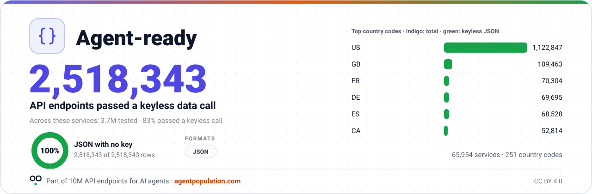
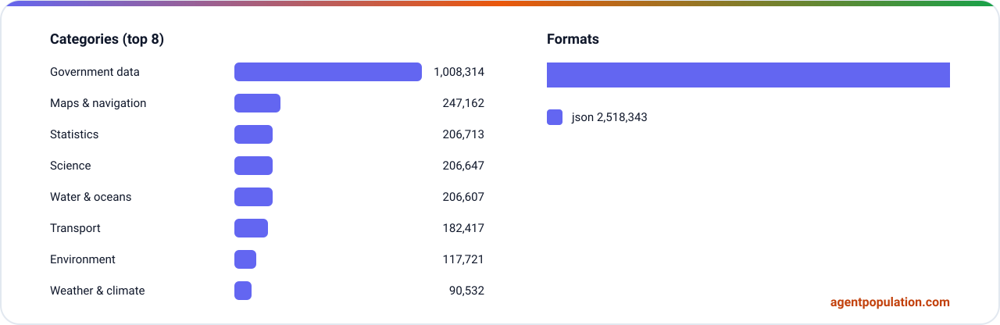

<p align="center"></p>

# 🤖 Agent-ready API endpoints

**2,518,343 agent-ready API endpoints that answered a keyless GET with a data body. For agent and app builders.**

<p align="center"><a href="#files"></a> <a href="#columns-and-tags"></a> <a href="#whats-inside"></a> <a href="#whats-inside"></a> <a href="LICENSE"></a></p>

<p align="center"><a href="#whats-in-it-for-you">What's in it</a> · <a href="#for-ai-agents">For AI agents</a> · <a href="#quick-start">Quick start</a> · <a href="#test-it-yourself">Test it yourself</a> · <a href="#files">Files</a> · <a href="#licence-and-credit">Licence</a> · <a href="#part-of-10m-api-endpoints-for-ai-agents">More packs</a></p>

This repository holds a 1,000-row sample and the services list; the full list of 2,518,343 endpoints is one download from the [latest release](https://github.com/agentpopulation/2.5m-agent-ready-apis/releases/latest).

**Endpoints for building an AI agent that calls endpoints with no key and reads JSON.** Endpoints from the weather, water, transport, statistics, government, health, hazards and map topics that answered a keyless GET with a JSON body on their test date: station and gauge readings, forecasts by point, country indicators, open-data records and map-layer queries. It is the keyless-JSON slice of the tested collection, so it overlaps the topic packs.

Selection rule: rows where `tags has agent-ready`, less the rows that a leave-out rule drops (each counted under Known limits).

1,506,212 of these 2,518,343 rows match the focus rule (below); the others are in the pack by the selection rule only, and Known limits says what they are. 970,976 rows (38.6%) are map layers on ArcGIS Online, where anyone can publish.

## In plain words

**What is an API endpoint?** An API endpoint is one web address that a program can ask for data, for example the latest reading at one weather station. A single service, such as a national weather agency, can have thousands of endpoints: one per station, city or dataset. This pack counts endpoints, not separate services.

**What does "passed a data call" mean?** On the date shown in each row, AgentPopulation sent one plain request to that address, with no password or key, and got a non-empty data body back (JSON, CSV, XML or a file): not an error page and not an empty result. Some bodies describe a dataset rather than hold its values; see Known limits. It shows the address answered with data on that day. It is not a promise that it answers today, and licences and usage limits were not reviewed.

## What's in it for you

Four ways to use this pack. Each bucket gives a count, a filter you can apply to the CSV, one example that passed, and a list of recommended starting points with the rule that picked them. Buckets overlap; a row can fit more than one.

Examples, recommended lists and the preview are drawn from rows that match this pack's focus rule, so a row that the selection rule put in this pack but that is about something else is not shown as a starting point. Counts cover the whole bucket.

<details>
<summary>The focus rule</summary>

Focus rule: `NOT url matches ///(services[0-9]*(-[a-z0-9]+)?|utility)\.arcgis\.com//i AND NOT url contains "/erddap/info/"`

</details>

### 🤖 Agent tools: Readings by station, gauge, airport or point for a lookup tool

**84,731** endpoints from 585 services · Wrap one URL pattern per source as a tool (get_observation, get_river_level, get_forecast, get_metar): pass a station id, airport code or coordinates, return the value, its unit and its time, with a timeout.

Start with: `subcategory matches /observation|gauge|metar|taf aerodrome|point forecast|forecast|tide|water level|river|met obs|timeseries|air quality|river temperature|station/i AND NOT subcategory matches /ArcGIS feature layer|dataset|OpenDataSoft|Open Data Portal|stationnement/i AND NOT url matches ///(services[0-9]*(-[a-z0-9]+)?|utility)\.arcgis\.com//i AND NOT url contains "/erddap/"`

Example: [EA flood monitoring: Silvertown (Thames Tideway)](https://environment.data.gov.uk/flood-monitoring/id/stations/0001/readings?latest) · UK Environment Agency data · passed 2026-11-14

<details>
<summary>Recommended starting points: 8 services, picked by the stated criteria inside</summary>

**Recommended starting points.** Selected by stated criteria, not a ranking of quality: Services in this pack with the most endpoints that match this bucket and are tagged `agent-ready` (no key sent in the test call, JSON body, passed a data call). Ties go to the service with more country codes, then by name. Only services with at least one bucket row that matches the focus rule are listed, and the sample comes from those rows; the counts cover the whole bucket. The sample URL is the first row by URL sort after preferring, in this order: rows that match the bucket's sample preference when it has one, rows that return values rather than describe a dataset or a service (not ERDDAP /info/ pages, OGC GetCapabilities requests, bare OWS addresses, PxWeb tables, UN SDG series lists, Statistics Canada download pointers, WorldPop listings, GTFS validation reports, untitled rows or service root addresses), and agent-ready rows. Services named "ArcGIS organization" hold map layers from many owners and are added only when fewer than 5 other services match.

| Service (host) | Endpoints in bucket | In pack | Country codes in bucket | Formats in bucket | Sample URL that passed |
|---|---:|---:|---|---|---|
| UK Environment Agency data (environment.data.gov.uk) | 12,094 | 12,110 | GB | json | [EA flood monitoring: Silvertown (Thames…](https://environment.data.gov.uk/flood-monitoring/id/stations/0001/readings?latest) (2026-11-14) |
| USGS Water Services (waterservices.usgs.gov) | 11,970 | 17,940 | 5 codes | json | [USGS National Water Information System:…](https://waterservices.usgs.gov/nwis/dv/?format=json&sites=01124350&period=P30D) (2026-11-15) |
| US Aviation Weather Center (aviationweather.gov) | 9,575 | 9,612 | 230 codes | json | [NOAA Aviation Weather Center: Airport i…](https://aviationweather.gov/api/data/airport?ids=AGGH&format=json) (2026-11-15) |
| MET Norway (api.met.no) | 8,757 | 10,029 | 242 codes | json | [MET Norway forecast: Kellé, Congo](https://api.met.no/weatherapi/locationforecast/2.0/compact?lat=-0.065&lon=14.5) (2026-11-14) |
| SMHI open meteorological observations (opendata-download-metobs.smhi.se) | 6,643 | 6,688 | SE | json | [SMHI weather: Lufttemperatur · Gustavsf…](https://opendata-download-metobs.smhi.se/api/version/1.0/parameter/1/station/103100/period/latest-day/data.json) (2026-11-14) |
| HubEau (French water data) (hubeau.eaufrance.fr) | 4,116 | 7,289 | FR | json | [Hub'Eau river temperature: L'HOGNEAU À …](https://hubeau.eaufrance.fr/api/v1/temperature/chronique?code_station=01001336&size=20&sort=desc) (2026-11-14) |
| NOAA CO-OPS tides and currents (api.tidesandcurrents.noaa.gov) | 4,020 | 7,098 | US | json | [NOAA CO-OPS Tides & Currents: CO-OPS la…](https://api.tidesandcurrents.noaa.gov/api/prod/datagetter?date=latest&datum=MLLW&station=1611400&product=water_level&units=metric&time_zone=gmt&format=json&application=AgentPopulation) (2026-11-14) |
| Sepa (timeseries.sepa.org.uk) | 2,216 | 2,216 | GB | json | [SEPA S 15minute: Perth](https://timeseries.sepa.org.uk/KiWIS/KiWIS?service=kisters&type=queryServices&datasource=0&request=getTimeseriesValues&ts_id=51453010&period=P1D&format=json) (2026-11-14) |

</details>

### 📱 App features: Bike-share, transit, parking, traffic and air-quality feeds for app cards and maps

**81,911** endpoints from 2,499 services · Show what is near a user on a card or a map: bikes and docks at a station, the status of a transit line, open parking spaces or the air-quality reading, refreshed when the card opens.

14,955 of these are GBFS bike-share or scooter feeds; the others are transit, parking, traffic and air-quality endpoints.

Start with: `(tags has bike-share OR tags has gbfs OR tags has transit OR tags has parking OR tags has traffic OR tags has air-quality) AND category in ("Transport & Mobility", "Environment", "Weather & Climate") AND NOT url matches ///(services[0-9]*(-[a-z0-9]+)?|utility)\.arcgis\.com//i AND NOT title or subcategory matches /^(municipal|city) open data|PxWeb|statistics:|eurostat/i AND NOT subcategory matches /ArcGIS feature layer|dataset|OpenDataSoft|Open Data Portal/i`

Example: [GBFS free\_bike\_status: biciArteixo (Artexio, ES)](https://gbfs.nextbike.net/maps/gbfs/v2/nextbike_aa/en/free_bike_status.json) · Nextbike · passed 2026-11-14

<details>
<summary>Recommended starting points: 8 services, picked by the stated criteria inside</summary>

**Recommended starting points.** Selected by stated criteria, not a ranking of quality: Services in this pack with the most endpoints that match this bucket and passed a data call. Ties go to the service with more country codes, then by name. Only services with at least one bucket row that matches the focus rule are listed, and the sample comes from those rows; the counts cover the whole bucket. The sample URL is the first row by URL sort after preferring, in this order: rows that match the bucket's sample preference when it has one, rows that return values rather than describe a dataset or a service (not ERDDAP /info/ pages, OGC GetCapabilities requests, bare OWS addresses, PxWeb tables, UN SDG series lists, Statistics Canada download pointers, WorldPop listings, GTFS validation reports, untitled rows or service root addresses), and agent-ready rows. Sample preference in this bucket: `url matches /station_status|free_bike_status|vehicle_status/i OR tags has air-quality OR subcategory matches /traffic|parking|status/i`. Services named "ArcGIS organization" hold map layers from many owners and are added only when fewer than 5 other services match.

| Service (host) | Endpoints in bucket | In pack | Country codes in bucket | Formats in bucket | Sample URL that passed |
|---|---:|---:|---|---|---|
| Nextbike (gbfs.nextbike.net) | 2,376 | 2,376 | 21 codes | json | [GBFS free\_bike\_status: biciArteixo (Art…](https://gbfs.nextbike.net/maps/gbfs/v2/nextbike_aa/en/free_bike_status.json) (2026-11-14) |
| Tfl (api.tfl.gov.uk) | 2,257 | 2,257 | GB | json | [TfL London air quality forecast](https://api.tfl.gov.uk/AirQuality) (2026-11-14) |
| tabular-api.data.gouv.fr | 1,752 | 10,684 | FR | json | [data.gouv.fr tabular API: Exposition de…](https://tabular-api.data.gouv.fr/api/resources/3c5459f9-c019-4a3e-bb87-b9189c55221e/data/?page_size=10) (2026-11-15) |
| Donkey (stables.donkey.bike) | 1,735 | 1,736 | 13 codes | json | [Donkey Republic Augsburg: GBFS free\_bik…](https://stables.donkey.bike/api/public/gbfs/2/Augsburg/de/free_bike_status.json) (2026-11-15) |
| Bird (mds.bird.co) | 1,224 | 1,224 | 12 codes | json | [Bird Ajaccio: GBFS free\_bike\_status \[en…](https://mds.bird.co/gbfs/ajaccio/free_bike_status.json) (2026-11-15) |
| Digitraffic (rata.digitraffic.fi) | 1,181 | 1,181 | FI, SE | json | [Fintraffic Digitraffic: Finnish train 1…](https://rata.digitraffic.fi/api/v1/train-tracking/2026-11-14/1) (2026-11-15) |
| api.mobidata-bw.de | 1,050 | 1,254 | CH, DE, LI | json | [MobiData BW sharing: GBFS free\_bike\_sta…](https://api.mobidata-bw.de/sharing/gbfs/v2/bird-basel/free_bike_status) (2026-11-15) |
| Open-Meteo air quality API (air-quality-api.open-meteo.com) | 1,043 | 1,043 | 242 codes | json | [Open-Meteo air quality: Quito, Ecuador](https://air-quality-api.open-meteo.com/v1/air-quality?latitude=-0.23&longitude=-78.52&current=pm10,pm2_5,us_aqi) (2026-11-14) |

</details>

### 🧠 Grounding and data pipelines: Country indicators and statistics tables for answers that cite a figure

**206,812** endpoints from 27,668 services · Load indicators and statistics tables on a schedule into your own store, so an agent answers with a figure, its period and the source URL.

Start with: `(category in ("Statistics & Economy", "Finance") OR subcategory matches /WHO Global Health|World Bank|SDG goal|UN SDG/i) AND NOT subcategory matches /PxWeb|PxWin|StatCan|WorldPop/i AND NOT host in (pxweb.stat.si, api.scb.se, data.ssb.no, andmed.stat.ee, openstat.psa.gov.ph, hub.worldpop.org)`

Example: [World Bank WDI AG.CON.FERT.ZS - Aruba](https://data360api.worldbank.org/data360/data?DATABASE_ID=WB_WDI&INDICATOR=WB_WDI_AG_CON_FERT_ZS&REF_AREA=ABW&top=20) · World Bank Data360 / WDI · passed 2026-11-14

<details>
<summary>Recommended starting points: 8 services, picked by the stated criteria inside</summary>

**Recommended starting points.** Selected by stated criteria, not a ranking of quality: Services in this pack with the most endpoints that match this bucket and passed a data call. Ties go to the service with more country codes, then by name. Only services with at least one bucket row that matches the focus rule are listed, and the sample comes from those rows; the counts cover the whole bucket. The sample URL is the first row by URL sort after preferring, in this order: rows that match the bucket's sample preference when it has one, rows that return values rather than describe a dataset or a service (not ERDDAP /info/ pages, OGC GetCapabilities requests, bare OWS addresses, PxWeb tables, UN SDG series lists, Statistics Canada download pointers, WorldPop listings, GTFS validation reports, untitled rows or service root addresses), and agent-ready rows. Sample preference in this bucket: `NOT url matches ///(services[0-9]*(-[a-z0-9]+)?|utility)\.arcgis\.com//i AND NOT url matches //GeoArea/|getFullTableDownloadCSV/i`. Services named "ArcGIS organization" hold map layers from many owners and are added only when fewer than 5 other services match.

| Service (host) | Endpoints in bucket | In pack | Country codes in bucket | Formats in bucket | Sample URL that passed |
|---|---:|---:|---|---|---|
| World Bank Data360 / WDI (data360api.worldbank.org) | 10,688 | 10,688 | 158 codes | json | [World Bank WDI AG.CON.FERT.ZS - Aruba](https://data360api.worldbank.org/data360/data?DATABASE_ID=WB_WDI&INDICATOR=WB_WDI_AG_CON_FERT_ZS&REF_AREA=ABW&top=20) (2026-11-14) |
| Portal Data Lamongan (data.lamongankab.go.id) | 8,260 | 8,847 | ID | json | [Jumlah Aparatur Pemerintah Desa Tracal …](https://data.lamongankab.go.id/dataset/0007fd8c-b341-4362-a10d-3b670c3bfc46/resource/c748c193-151f-4eba-ab14-b3220fba66df/download/data_statistik.json) (2026-11-15) |
| Ireland Open Data Portal (ws.cso.ie) | 6,805 | 11,813 | IE | json | [A0101 - 1996 Population and Percentage …](https://ws.cso.ie/public/api.restful/PxStat.Data.Cube_API.ReadDataset/A0101/JSON-stat/1.0/en) (2026-11-15) |
| Eurostat dissemination API (ec.europa.eu) | 5,689 | 7,444 | EU | json | [Eurostat: Unit values at basic prices (…](https://ec.europa.eu/eurostat/api/dissemination/statistics/1.0/data/aact_uv01?lang=en&lastTimePeriod=1) (2026-11-14) |
| CBS StatLine (Netherlands) (opendata.cbs.nl) | 5,481 | 5,978 | NL | json | [CBS Netherlands: Redenen die een belang…](https://opendata.cbs.nl/ODataApi/odata/00370/TypedDataSet?$top=10&$format=json) (2026-11-14) |
| Datos Abiertos de Canarias (datos.canarias.es) | 4,918 | 6,636 | ES | json | [Indicadores laborales. Barrios de Canar…](https://datos.canarias.es/api/estadisticas/geographical-resources/epareg/ows?service=WFS&version=1.1.0&request=GetFeature&typeName=Barrios-2017&outputFormat=application/json) (2026-11-15) |
| UN Statistics / SDG API (unstats.un.org) | 4,755 | 4,755 | 188 codes | json | [UN SDG: Global food loss index](https://unstats.un.org/sdgapi/v1/sdg/Series/Data?seriesCode=AG_FLS_INDEX&pageSize=10) (2026-11-14) |
| Azureedge (ghoapi.azureedge.net) | 3,061 | 3,061 | 172 codes | json | [WHO GHO: Ambient air pollution attribut…](https://ghoapi.azureedge.net/api/AIR_42?$filter=SpatialDim%20eq%20%27AFG%27) (2026-11-14) |

</details>

### 🧪 Evals and testing: A spread of topics and JSON shapes to test a tool-calling agent

**2,518,343** endpoints · 65,954 services · 251 country codes · 1 format · Run your agent against a fixed set of URLs from many services and topics; check that each JSON body parses into the fields your tools return, and keep last_tested as the baseline for your own re-tests.

Start with: the whole pack

Example: [USGS National Water Information System: NWIS dail…](https://waterservices.usgs.gov/nwis/dv/?format=json&sites=01124350&period=P30D) · USGS Water Services · passed 2026-11-15

<details>
<summary>Recommended starting points: 8 services, picked by the stated criteria inside</summary>

**Recommended starting points.** Selected by stated criteria, not a ranking of quality: Services in this pack that returned the most different formats, then the most endpoints that passed a data call, then by name: a mix of response shapes to test parsers and tool calls. Here the services returned 1 format each, so the order comes down to endpoint counts. Only services with at least one bucket row that matches the focus rule are listed, and the sample comes from those rows; the counts cover the whole bucket. The sample URL is the first row by URL sort after preferring, in this order: rows that match the bucket's sample preference when it has one, rows that return values rather than describe a dataset or a service (not ERDDAP /info/ pages, OGC GetCapabilities requests, bare OWS addresses, PxWeb tables, UN SDG series lists, Statistics Canada download pointers, WorldPop listings, GTFS validation reports, untitled rows or service root addresses), and agent-ready rows. Services named "ArcGIS organization" hold map layers from many owners and are added only when fewer than 5 other services match.

| Service (host) | Endpoints in bucket | In pack | Country codes in bucket | Formats in bucket | Sample URL that passed |
|---|---:|---:|---|---|---|
| USGS Water Services (waterservices.usgs.gov) | 17,940 | 17,940 | 5 codes | json | [USGS National Water Information System:…](https://waterservices.usgs.gov/nwis/dv/?format=json&sites=01124350&period=P30D) (2026-11-15) |
| Statistics Norway PxWeb (data.ssb.no) | 16,665 | 16,665 | NO | json | [Norway statistics: 13938: Employed pers…](https://data.ssb.no/api/v0/en/table/al/al03/aku/SBMENU10954/AKU22) (2026-11-15) |
| Catálogo de datos abiertos del IBESTAT (intranet.caib.es) | 16,515 | 16,515 | ES | json | [urn-siemac-es-caib-ibestat-infomodel-ja…](https://intranet.caib.es/ibestat-jaxi/tabla.do?typeDownload=6&px=00045648-aa4e-4604-9012-6232cb1f4e94) (2026-11-15) |
| UK Environment Agency data (environment.data.gov.uk) | 12,110 | 12,110 | GB, US | json | [environment.data.gov.uk: AdminBoundEAan…](https://environment.data.gov.uk/KB6uNVj5ZcJr7jUP/ArcGIS/rest/services/AdminBoundEAandNEpublicFaceAreas/FeatureServer/0/query?where=1%3D1&outFields=*&resultRecordCount=10&f=json) (2026-11-15) |
| Ireland Open Data Portal (ws.cso.ie) | 11,813 | 11,813 | IE | json | [A0101 - 1996 Population and Percentage …](https://ws.cso.ie/public/api.restful/PxStat.Data.Cube_API.ReadDataset/A0101/JSON-stat/1.0/en) (2026-11-15) |
| World Bank Data360 / WDI (data360api.worldbank.org) | 10,688 | 10,688 | 158 codes | json | [World Bank WDI AG.CON.FERT.ZS - Aruba](https://data360api.worldbank.org/data360/data?DATABASE_ID=WB_WDI&INDICATOR=WB_WDI_AG_CON_FERT_ZS&REF_AREA=ABW&top=20) (2026-11-14) |
| tabular-api.data.gouv.fr | 10,684 | 10,684 | FR | json | [data.gouv.fr tabular API: Programme heb…](https://tabular-api.data.gouv.fr/api/resources/000516a1-93b8-4183-9ad9-5c324f086e14/data/?page_size=10) (2026-11-15) |
| www.datos.gov.co | 10,137 | 10,137 | CO | json | [Estadistica UNDMO](https://www.datos.gov.co/resource/226x-qjxq.json?$limit=1) (2026-11-15) |

</details>

The same lists are in [recommended.json](recommended.json), ready for an agent to load.

## Questions an agent can answer with this pack

- What is the latest METAR at a given airport? Try [METAR: Honiara/Henderson Arpt (AGGH)](https://aviationweather.gov/api/data/metar?ids=AGGH&format=json) (US Aviation Weather Center, passed 2026-11-14).
- How has a US river gauge moved over the last six hours? Try [USGS real-time: St. John River At Ninemile Bridge…](https://waterservices.usgs.gov/nwis/iv/?format=json&sites=01010000&period=PT6H) (USGS Water Services, passed 2026-11-14).
- What total population does the World Bank report for a country? Try [World Bank WDI SP.POP.TOTL - Aruba](https://data360api.worldbank.org/data360/data?DATABASE_ID=WB_WDI&INDICATOR=WB_WDI_SP_POP_TOTL&REF_AREA=ABW&top=20) (World Bank Data360 / WDI, passed 2026-11-14).

## What "passed a data call" means

> [!NOTE]
> On the date in `last_tested` (IST), one GET to the URL, sent with no key, returned HTTP 2xx and a non-empty data body. HTML pages and empty results did not pass. The `format` column records what came back. This is a test result for that date, not a promise that the URL answers today. Licences, terms, rate limits, accuracy and freshness were not reviewed. Endpoints are URLs, not separate APIs; many share one service. This pack was tested 10–15 Nov 2026; snapshot 15 Nov 2026.

## For AI agents

Start from keyless JSON endpoints (`agent-ready`). The code below loads `recommended.json` and calls the first recommended service in the Agent tools bucket, with a timeout (`node examples/agent-start.mjs --recommended`). With no argument, `node examples/agent-start.mjs` calls the most recently tested agent-ready row of the sample; pass a `.csv` or `.csv.gz` path to use that file instead. See [examples/agent-start.mjs](examples/agent-start.mjs).

```js
// Node 18+. Loads recommended.json (the local copy, or the raw file on GitHub) and calls one keyless JSON endpoint.
import fs from 'node:fs';

const RAW = 'https://raw.githubusercontent.com/agentpopulation/2.5m-agent-ready-apis/main/recommended.json';
const rec = fs.existsSync('recommended.json')
  ? JSON.parse(fs.readFileSync('recommended.json', 'utf8'))
  : await (await fetch(RAW)).json();

const pick = rec.buckets.find((b) => b.id === 'agent').services[0];
try {
  const res = await fetch(pick.sample_url, {
    headers: { 'User-Agent': 'agent-example/1.0' },
    signal: AbortSignal.timeout(15000),
  });
  console.log(pick.service, res.status, res.headers.get('content-type'));
  console.log((await res.text()).slice(0, 300));
} catch (err) {
  console.log(`did not answer now; last passed ${pick.sample_last_tested} (${err.message})`);
}
```

How an agent picks an endpoint:

1. Filter to `agent-ready` and your country or topic.
2. Prefer the newest `last_tested` and the larger services.
3. Call with a timeout and check the body before you use it.

## Quick start

The examples run against the sample in `data/` out of the box (1,000 rows). Each takes an optional path to a `.csv` or `.csv.gz` file instead.

```bash
git clone https://github.com/agentpopulation/2.5m-agent-ready-apis.git
cd 2.5m-agent-ready-apis
python examples/quickstart.py
node examples/quickstart.mjs
node examples/agent-start.mjs
```

Full list: download `Agent_Ready_API_Endpoints_AgentPopulation_Snapshot_2026-11-15.csv.gz` (2,518,343 rows, 83.3 MB) from [releases/latest](https://github.com/agentpopulation/2.5m-agent-ready-apis/releases/latest), then gunzip it and pass its path. The scripts also read the `.csv.gz` as it is.

```bash
gunzip Agent_Ready_API_Endpoints_AgentPopulation_Snapshot_2026-11-15.csv.gz
python examples/quickstart.py Agent_Ready_API_Endpoints_AgentPopulation_Snapshot_2026-11-15.csv
node examples/quickstart.mjs Agent_Ready_API_Endpoints_AgentPopulation_Snapshot_2026-11-15.csv
```

### curl

Quote the URL: some contain commas.

```bash
curl -sL "https://raw.githubusercontent.com/agentpopulation/2.5m-agent-ready-apis/main/data/Agent_Ready_API_Endpoints_AgentPopulation_Sample.csv" | head -n 4
curl -s --max-time 15 "https://environment.data.gov.uk/flood-monitoring/id/stations/0001/readings?latest" | head -c 600
```

### Python

Standard library only: [examples/quickstart.py](examples/quickstart.py) reads the sample, or the path you pass, keeps agent-ready rows and calls the most recently tested one.

<details>
<summary>The code</summary>

```python
# Python 3, standard library only. Run from a clone of this repository:
#   python examples/quickstart.py [path]
# With no path it reads the sample in data/. Pass the full list from the latest release (.csv or .csv.gz) instead.
# Keeps agent-ready rows and calls the most recently tested one.
import csv
import gzip
import os
import re
import sys
import urllib.request

HERE = os.path.dirname(os.path.abspath(__file__))
path = sys.argv[1] if len(sys.argv) > 1 else os.path.join(HERE, "..", "data", "Agent_Ready_API_Endpoints_AgentPopulation_Sample.csv")
opener = gzip.open if path.endswith(".gz") else open
with opener(path, "rt", newline="", encoding="utf-8") as f:
    rows = list(csv.DictReader(f))

agent = [r for r in rows if "agent-ready" in r["tags"].split("|")]
# Newest test date first; URLs that describe a dataset or a service rather than return values go last.
DESCRIBES = re.compile(r"/erddap/info/|action-report\.json$|[?&]request=getcapabilities|/GeoArea/[^/?]+/List|getFullTableDownloadCSV|hub\.worldpop\.org", re.I)
agent.sort(key=lambda r: r["last_tested"], reverse=True)
agent.sort(key=lambda r: 1 if DESCRIBES.search(r["url"]) else 0)
print(len(rows), "rows,", len(agent), "agent-ready")
if not agent:
    sys.exit(0)

row = agent[0]
req = urllib.request.Request(row["url"], headers={"User-Agent": "agent-example/1.0"})
try:
    with urllib.request.urlopen(req, timeout=15) as res:
        body = res.read(1_000_000).decode("utf-8", "replace")
        print(res.status, res.headers.get("Content-Type"))
        print(body[:300])
except Exception as err:
    print(f"did not answer now; last passed {row['last_tested']} ({err})")
```

</details>

### JavaScript

Reads the sample as JSON because the CSV has quoted commas.

<details>
<summary>The code</summary>

```js
// Node 18+. Reads the sample as JSON (the CSV has quoted commas), local file first.
import fs from 'node:fs';

const FILE = 'data/Agent_Ready_API_Endpoints_AgentPopulation_Sample.json';
const rows = fs.existsSync(FILE)
  ? JSON.parse(fs.readFileSync(FILE, 'utf8'))
  : await (await fetch('https://raw.githubusercontent.com/agentpopulation/2.5m-agent-ready-apis/main/data/Agent_Ready_API_Endpoints_AgentPopulation_Sample.json')).json();

const row = rows.find((r) => r.tags.includes('agent-ready'));
const res = await fetch(row.url, { headers: { 'User-Agent': 'agent-example/1.0' }, signal: AbortSignal.timeout(15000) });
console.log(res.status, (await res.text()).slice(0, 300));
```

</details>

### Agent tools

[examples/agent-tools.json](examples/agent-tools.json) holds two tool definitions in the shape most tool-calling APIs accept (name, description, JSON Schema); rename `parameters` if yours uses another key. [examples/quickstart.mjs](examples/quickstart.mjs) implements them:

- `find_endpoints` searches the agent-ready rows of the list by words, country code (their format is json). When you load the tools of more than one pack, prefix the names (for example `agent_ready_find_endpoints`) so they do not clash.
- `fetch_endpoint` calls one URL, **refuses any URL that is not in the list** and does not follow redirects. The allowlist is built from the CSV, so a URL injected into a prompt is refused.

The same two tools can sit behind an MCP server.

## Test it yourself

Re-test endpoints from the sample with the same rule: HTTP 2xx and a non-empty body that is not an HTML page. Node 18+, no packages.

```bash
node tools/test-endpoints.mjs
```

It tests the first 50 URLs and prints one line: tested, passed, did not pass. Options: a `.csv` or `.csv.gz` path (the full list from the release), `--limit 50`, `--timeout-ms 10000`, `--out results.csv`. The results file holds `url`, `status`, `passed`, `content_type`, `ms` and `checked_at`; a status of `timeout` or `error:<code>` means no HTTP answer came back. It is polite: GET only, no key sent, at most 4 requests in flight, one at a time per listed host, at least 1 second between requests to one listed host, and reading stops once 256 kB of a body is kept. Redirects are followed and may lead to another host. `results.csv` is in `.gitignore`.

## Preview

One row from each of the five largest services among rows that match the focus rule, services with rows that return values first.

| Title | Service | Country | Format | Tested | Link |
|---|---|---|---|---|---|
| USGS National Water Information System: NWIS daily values (… | USGS Water Services | US | json | 2026-11-15 | [waterservices.usgs.gov](https://waterservices.usgs.gov/nwis/dv/?format=json&sites=01124350&period=P30D) |
| urn-siemac-es-caib-ibestat-infomodel-jaxi-dataset-ibestat-v… | Catálogo de datos abiertos del IBESTAT | ES | json | 2026-11-15 | [intranet.caib.es](https://intranet.caib.es/ibestat-jaxi/tabla.do?typeDownload=6&px=00045648-aa4e-4604-9012-6232cb1f4e94) |
| environment.data.gov.uk: AdminBoundEAandNEpublicFaceAreas /… | UK Environment Agency data | GB | json | 2026-11-15 | [environment.data.gov.uk](https://environment.data.gov.uk/KB6uNVj5ZcJr7jUP/ArcGIS/rest/services/AdminBoundEAandNEpublicFaceAreas/FeatureServer/0/query?where=1%3D1&outFields=*&resultRecordCount=10&f=json) |
| A0101 - 1996 Population and Percentage Change 1991 and 1996… | Ireland Open Data Portal | IE | json | 2026-11-15 | [ws.cso.ie](https://ws.cso.ie/public/api.restful/PxStat.Data.Cube_API.ReadDataset/A0101/JSON-stat/1.0/en) |
| World Bank WDI AG.CON.FERT.ZS - Aruba | World Bank Data360 / WDI | AW | json | 2026-11-14 | [data360api.worldbank.org](https://data360api.worldbank.org/data360/data?DATABASE_ID=WB_WDI&INDICATOR=WB_WDI_AG_CON_FERT_ZS&REF_AREA=ABW&top=20) |

Browse the 1,000-row sample: [Sample CSV](data/Agent_Ready_API_Endpoints_AgentPopulation_Sample.csv) · [Sample JSON](data/Agent_Ready_API_Endpoints_AgentPopulation_Sample.json).

## What's inside

<p align="center"></p>

<details>
<summary>Country codes: 251</summary>

| Code | Country | Endpoints | |
|---|---|---:|---|
| US | United States | 1,122,847 | `████████████████████` |
| GB | United Kingdom | 109,463 | `██` |
| FR | France | 70,304 | `█▎` |
| DE | Germany | 69,695 | `█▎` |
| ES | Spain | 68,528 | `█▎` |
| CA | Canada | 52,814 | `█` |
| IT | Italy | 46,243 | `▉` |
| CO | Colombia | 38,492 | `▋` |
| IN | India | 32,824 | `▋` |
| NL | Netherlands | 32,578 | `▋` |
| | other 241 codes | 676,276 | |
| | global or unknown | 198,279 | `███▌` |

</details>

<details>
<summary>Categories: top 8</summary>

| Category | Endpoints | |
|---|---:|---|
| Government & Open Data | 1,008,314 | `████████████████████` |
| Navigation & Geo/Maps | 247,162 | `████▉` |
| Statistics & Economy | 206,713 | `████▏` |
| Science | 206,647 | `████▏` |
| Hydrology & Oceans | 206,607 | `████▏` |
| Transport & Mobility | 182,417 | `███▋` |
| Environment | 117,721 | `██▍` |
| Weather & Climate | 90,532 | `█▊` |

</details>

Formats: json 2,518,343

<details>
<summary>Largest services: top 25 of 65,954</summary>

| Service | Host | Endpoints | Keyless JSON | |
|---|---|---:|---:|---|
| USGS Water Services | waterservices.usgs.gov | 17,940 | 17,940 | `████████████████████` |
| Statistics Norway PxWeb | data.ssb.no | 16,665 | 16,665 | `██████████████████▋` |
| Catálogo de datos abiertos del IBESTAT | intranet.caib.es | 16,515 | 16,515 | `██████████████████▍` |
| UK Environment Agency data | environment.data.gov.uk | 12,110 | 12,110 | `█████████████▌` |
| Ireland Open Data Portal | ws.cso.ie | 11,813 | 11,813 | `█████████████▏` |
| GRIIDC ERDDAP (Gulf of Mexico) † | erddap.griidc.org | 11,688 | 11,688 | `█████████████` |
| World Bank Data360 / WDI | data360api.worldbank.org | 10,688 | 10,688 | `███████████▉` |
| tabular-api.data.gouv.fr | tabular-api.data.gouv.fr | 10,684 | 10,684 | `███████████▉` |
| www.datos.gov.co | www.datos.gov.co | 10,137 | 10,137 | `███████████▎` |
| MET Norway (api.met.no) | api.met.no | 10,029 | 10,029 | `███████████▏` |
| Statistical Office of Slovenia PxWeb | pxweb.stat.si | 9,756 | 9,756 | `██████████▉` |
| US Aviation Weather Center | aviationweather.gov | 9,612 | 9,612 | `██████████▊` |
| Italia Dati municipal dashboards | cruscotto-italia.dati.gov.it | 9,194 | 9,194 | `██████████▎` |
| Portal Data Lamongan | data.lamongankab.go.id | 8,847 | 8,847 | `█████████▉` |
| Datos Abiertos Colombia | datos.gov.co | 8,249 | 8,249 | `█████████▎` |
| Tamu | gcoos5.geos.tamu.edu | 7,738 | 7,738 | `████████▋` |
| Eurostat dissemination API | ec.europa.eu | 7,444 | 7,444 | `████████▎` |
| HubEau (French water data) | hubeau.eaufrance.fr | 7,289 | 7,289 | `████████▏` |
| NOAA CO-OPS tides and currents | api.tidesandcurrents.noaa.gov | 7,098 | 7,098 | `███████▉` |
| Doi | doi.org | 6,810 | 6,810 | `███████▋` |
| SMHI open meteorological observations | opendata-download-metobs.smhi.se | 6,688 | 6,688 | `███████▌` |
| Datos Abiertos de Canarias | datos.canarias.es | 6,636 | 6,636 | `███████▍` |
| PNDB Open Data | pndb.opendatasoft.com | 6,516 | 6,516 | `███████▎` |
| Statistics Sweden (SCB) PxWeb | api.scb.se | 6,149 | 6,149 | `██████▉` |
| CBS StatLine (Netherlands) | opendata.cbs.nl | 5,978 | 5,978 | `██████▋` |

† No row of this service matches the focus rule: the selection rule put it in this pack, so it is not used as a starting point.

</details>

<details>
<summary>Rows per test date: 10–15 Nov 2026</summary>

| Date (IST) | Endpoints | |
|---|---:|---|
| 2026-11-15 | 1,835,474 | `████████████████████` |
| 2026-11-14 | 551,959 | `██████` |
| 2026-11-13 | 19,841 | `▎` |
| 2026-11-12 | 81,043 | `▉` |
| 2026-11-11 | 29,935 | `▍` |
| 2026-11-10 | 91 | `▏` |

</details>

## Files

| File | Rows | Size | Use |
|---|---:|---:|---|
| [data/Agent_Ready_API_Services_AgentPopulation.csv](data/Agent_Ready_API_Services_AgentPopulation.csv) | 65,954 | 3.4 MB | One row per service with its endpoint count in this pack |
| [data/Agent_Ready_API_Endpoints_AgentPopulation_Sample.csv](data/Agent_Ready_API_Endpoints_AgentPopulation_Sample.csv) | 1,000 | 275.7 kB | The sample: focus-rule rows first, each service in proportion to its share; ArcGIS Online layers count as one service |
| [data/Agent_Ready_API_Endpoints_AgentPopulation_Sample.json](data/Agent_Ready_API_Endpoints_AgentPopulation_Sample.json) | 1,000 | 469.5 kB | The same rows as JSON, tags as an array |
| [Agent_Ready_API_Endpoints_AgentPopulation_Snapshot_2026-11-15.csv.gz](https://github.com/agentpopulation/2.5m-agent-ready-apis/releases/latest) | 2,518,343 | 83.3 MB | The full list, gzipped CSV: a download from the latest release, checked by `SHA256SUMS.txt` |
| [tools/test-endpoints.mjs](tools/test-endpoints.mjs) | | | Re-tests endpoints from the sample or the full list |

Sample size: 1,000 rows, which is 1,000 or one third of the pack rounded down, whichever is smaller. Rows that match the focus rule come first. Each service gets rows in proportion to its share of those rows, at least one for the largest services and at most 50% of the sample while other services have rows; ArcGIS Online layers count as one service, whatever their organisation. Within a service, agent-ready rows, rows that return values and the newest test dates come first, and rows are written in turn across services. Service root addresses are placed at the end of the sample.

Full list: download `Agent_Ready_API_Endpoints_AgentPopulation_Snapshot_2026-11-15.csv.gz` (2,518,343 rows, 83.3 MB) from [releases/latest](https://github.com/agentpopulation/2.5m-agent-ready-apis/releases/latest), then gunzip it and pass its path. The scripts also read the `.csv.gz` as it is.

Excel users: Data > From Text/CSV, UTF-8. Files are UTF-8 without a byte-order mark and comma-separated.

## Columns and tags

<details>
<summary>Columns, types and tags</summary>

| Column | Type | Example | Meaning |
|---|---|---|---|
| url | string | [https://waterservices.usgs.gov/nwis/dv/…](https://waterservices.usgs.gov/nwis/dv/?format=json&sites=01124350&period=P30D) | The address that was tested |
| title | string | USGS National Water Information System:… | Station, dataset or feed name |
| service | string | USGS Water Services | The service the endpoint belongs to; joins to the services file together with host |
| host | string | waterservices.usgs.gov | Host name of the address |
| country | string | US | ISO 3166-1 alpha-2 code, or EU; empty when global or unknown |
| category | string | Hydrology & Oceans | Category of the endpoint |
| subcategory | string |  | Left empty from the 15 Nov 2026 snapshot; kept so the columns stay the same |
| format | string | json | What the test call returned: json, csv, geojson, xml, gtfs, zip, txt and so on |
| tags | string | `water\|rivers\|no-key\|json\|agent-ready` | Tags separated by \| |
| last_tested | date | 2026-11-15 | Date of the test call, YYYY-MM-DD (IST) |

| Tag | Rows | Meaning |
|---|---:|---|
| agent-ready | 2,518,343 | No key sent, JSON body, passed a data call on last_tested |
| json | 2,518,343 | Format of the body |
| no-key | 2,518,343 | No key was sent in the test call |
| maps | 1,251,732 | Topic tag |
| open-data | 1,164,189 | Topic tag |
| government | 1,068,480 | Topic tag |
| statistics | 274,183 | Topic tag |
| science | 235,870 | Topic tag |
| water | 206,607 | Topic tag |
| transit | 196,825 | Topic tag |
| environment | 141,755 | Topic tag |
| weather | 120,518 | Topic tag |
| ai-ml | 102,689 | Topic tag |
| health | 76,824 | Topic tag |
| finance | 73,301 | Topic tag |
| rivers | 71,514 | Topic tag |
| oceans | 68,292 | Topic tag |
| energy | 55,204 | Topic tag |
| hazards | 47,014 | Topic tag |
| floods | 28,234 | Topic tag |
| aviation | 25,762 | Topic tag |
| forecast | 21,325 | Topic tag |
| economy | 18,861 | Topic tag |
| maritime | 16,740 | Topic tag |
| groundwater | 16,191 | Topic tag |
| bike-share | 16,136 | Topic tag |
| gbfs | 15,095 | GBFS feed |
| traffic | 14,472 | Topic tag |
| elevation | 13,173 | Topic tag |
| tides | 12,448 | Topic tag |
| climate | 12,061 | Topic tag |
| air-quality | 10,830 | Topic tag |
| parking | 10,126 | Topic tag |
| earthquakes | 8,696 | Topic tag |
| wildfire | 6,285 | Topic tag |
| mcp-server | 3,142 | Topic tag |
| volcanoes | 2,177 | Topic tag |
| geocoding | 1,555 | Topic tag |
| tsunami | 1,335 | Topic tag |
| speech | 331 | Topic tag |
| gtfs | 309 | GTFS feed |
| llm | 85 | Topic tag |
| embeddings | 67 | Topic tag |
| image-gen | 4 | Topic tag |

A machine-readable copy of this dictionary is in [datapackage.json](datapackage.json).

</details>

## Known limits

- 44.6% of rows carry country code US; 198,279 rows have no code (global or unknown).
- 66,002 rows come from PxWeb or Statistics Canada services. Some statistics endpoints return metadata or a pointer on GET; the table may need a second request or a POST.
- 44,704 rows are ERDDAP /info/ pages: they describe a dataset rather than return its values, so the series needs a second request.
- 1,198,428 rows are map-layer queries with resultRecordCount set: the tested call asked for a few records; change the query to get the full layer.
- 123,610 rows carry limit=1: the tested call asked for one record; raise the limit or page through.
- 135,219 rows are open-data portal dataset records, which may return a dataset record with links rather than the table itself.
- 2,071 rows are service root addresses (the host alone or an API or version path such as /v1, with no query), which may describe the service rather than return data; the sample, examples and recommended lists use other rows first.
- 6,768 URLs carry `application=AgentPopulation`; set your own application name when you call them.
- This pack is the keyless-JSON slice of the tested collection: an endpoint here can also sit in a topic pack (weather, transit, water, finance, maps and others). Use a topic pack when you need one subject.
- 967,427 rows are layers on ArcGIS Online, where anyone can publish: some are class projects, tests or copies, and a short title such as "Weather" says little about what a layer holds. Check the owner and the fields before you rely on one; they are not used as starting points.
- Stations and feeds can go quiet after their test date; re-test a URL before you rely on it.
- Not in this pack: endpoints that need a key or a POST, and URLs that did not pass.
- Left out: 1,747 rows whose URL carried a credential-looking parameter or a login.
- Left out: 52 rows with a private or local address.
- Left out: 134 rows with an email-like address.
- Left out: 43,873 ArcGIS Survey123 layers (they can hold people's form answers).
- Left out: 12 camera or image URLs (webcam and camera feeds, picture and video files).
- Left out: 1,241 class-exercise copies of the same few ArcGIS Online layers (Miami Beach sea level rise, high-risk areas without shelter, flooded areas, sea level rise and storm surge maps) across many organisations, many with a person's name in the title.
- Left out: 508 layers marked editable in the title (they can hold entries that people added).
- Left out: 63 police traffic-stop layers (they can hold details of people stopped).
- Left out: 7,384 ArcGIS layers that keep a form's default service name (they can hold people's form answers).
- Left out: 118 rows that passed a data call only from a network location in India.
- Left out: 6 rows whose address or title held a token-like string, a private address or a similar string.
- Left out: 29,512 ArcGIS class or coursework layers (lab, assignment, exam, quiz, lesson, exercise, tutorial and final-project layers, copies of class layers, layers named for a person or a person's home, and layers whose name ends in a person's name or holds a student number).
- Left out: 2,829 ArcGIS layers that hold reports, comments, submissions or form responses sent in by the public.
- Left out: 102,908 rows of server information from Mastodon, PeerTube, Lemmy, Nostr and other social network servers (instance documents name the server's contact person).
- Left out: 1 row that repeats an address already in the pack.

## Licence and credit

> [!IMPORTANT]
> This list (URLs, titles, tags and test results) is © 2026 AgentPopulation, released under [CC BY 4.0](https://creativecommons.org/licenses/by/4.0/). Credit AgentPopulation and link agentpopulation.com. The data each endpoint returns belongs to its provider and stays under that provider's terms; this licence does not cover it.

Copy-ready credit:

`Agent-ready API endpoints by AgentPopulation (https://agentpopulation.com), CC BY 4.0, snapshot 15 Nov 2026.`

GitHub's "Cite this repository" button reads [CITATION.cff](CITATION.cff).

<!-- agentpopulation:start -->
## Part of 10M API endpoints for AI agents

This pack is one of the 24 topic packs of [10m-open-apis-for-ai-agents](https://github.com/agentpopulation/10m-open-apis-for-ai-agents), the open collection by [AgentPopulation](https://agentpopulation.com). Target: 10 million+ open API endpoints that pass a keyless API call.

AgentPopulation has tested over 5 million API endpoints: 5,129,834 tested, 3,726,509 passed a data call (snapshot 15 Nov 2026). This is the agent-ready pack: 2,518,343 endpoints from 65,954 services. Packs overlap, so an endpoint can appear in more than one.

For the latest tested endpoints, search [agentpopulation.com/apis](https://agentpopulation.com/apis). This pack is a snapshot from 15 Nov 2026.

Sibling packs that share the most URLs with this one: [1.3m-government-open-data-apis](https://github.com/agentpopulation/1.3m-government-open-data-apis) (1,008,314 shared) · [380k-maps-gis-apis-for-agents](https://github.com/agentpopulation/380k-maps-gis-apis-for-agents) (247,162 shared) · [270k-water-apis-for-agents](https://github.com/agentpopulation/270k-water-apis-for-agents) (226,036 shared) · [290k-statistics-apis-for-agents](https://github.com/agentpopulation/290k-statistics-apis-for-agents) (206,713 shared) · [380k-science-apis-for-agents](https://github.com/agentpopulation/380k-science-apis-for-agents) (206,647 shared) · [270k-transit-apis-for-agents](https://github.com/agentpopulation/270k-transit-apis-for-agents) (196,830 shared). The rest are listed in [10m-open-apis-for-ai-agents](https://github.com/agentpopulation/10m-open-apis-for-ai-agents).

Questions, pack requests, reports of endpoints that stopped answering and requests to remove a row go to [Discussions](https://github.com/agentpopulation/10m-open-apis-for-ai-agents/discussions), or to [@agentpopulation](https://x.com/agentpopulation) on X. The packs are a work in progress and corrections are welcome.

Spotted a wrong row or a dead URL? Tell us on X: [@agentpopulation](https://x.com/agentpopulation).

If this pack saved you time, a star helps others find it.

---

Compiled by [AgentPopulation](https://agentpopulation.com) with [AP Desk](https://github.com/agentpopulation/apdesk) · [10m-open-apis-for-ai-agents](https://github.com/agentpopulation/10m-open-apis-for-ai-agents)

<!-- agentpopulation:end -->
